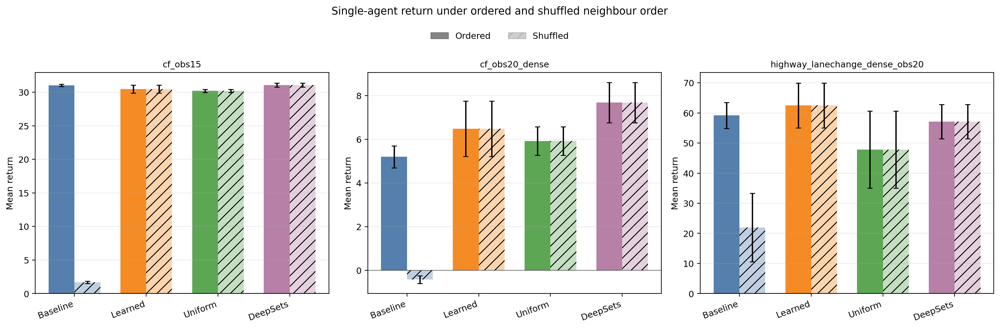

# Attention and Set Encoders for Highway Driving

**Final-year research on neighbour representation in reinforcement learning, built on [highway-env](https://github.com/Farama-Foundation/HighwayEnv).**

This repository contains the implementation and experiment artefacts for **Applying Attention Mechanisms to Reinforcement Learning for Highway Driving**, by **Theodoros Hadjitofis**, supervised by **Dr. Mélanie Bouroche**, School of Computer Science and Statistics, **Trinity College Dublin**. The dissertation was submitted for the B.A. (Mod) Computer Science degree and is dated 19 April 2026.

The project asks how the representation of nearby vehicles affects **driving performance, robustness to neighbour ordering, and the interpretation of learned attention**. It compares PPO controllers with a flattened MLP, learned masked attention, uniform attention, and DeepSets, then extends the investigation to shared-policy PPO and a custom MAPPO-style implementation.

Set-based encoders are much more robust to shuffled neighbour rows than the flattened MLP. DeepSets has the highest mean return in four of the five ordered single-agent scenarios. Learned attention leads in the dense lane-change task. In the multi-agent experiments, improved robustness did not consistently translate into higher returns.

[Dissertation snapshot](#dissertation-snapshot) · [Models](#models-and-observations) · [Scenarios](#traffic-scenarios) · [Results](#results) · [Setup](#setup) · [Citation](#attribution-and-citation)

## Dissertation snapshot

The default branch, `master`, includes the final research implementation merged from `exp/scenarios_v12`. The original dissertation snapshot remains available on that branch at commit [`a945033a`](https://github.com/teotof/HighwayEnv/tree/a945033a7c6af4367b5fd80066b917a7545fd101). Use that commit to pair the saved models and logs with the simulator code used for the dissertation.

The earlier `cf_v2` pilot used a one-lane `highway-v0` configuration and a different reward setup. Its results belong to the development phase. [Pilot code](https://github.com/teotof/HighwayEnv/tree/d27607082e8e03b92197936c08587eca4f5019ed/experiments) · [Pilot results](https://github.com/teotof/HighwayEnv/tree/d27607082e8e03b92197936c08587eca4f5019ed/experiments_results)

| Material | Verified availability |
|---|---|
| Early `cf_v2` PPO baseline and attention experiment | Historical commits and experiment branches |
| Final custom scenarios, attention controls, DeepSets, shared-policy PPO, MAPPO, evaluation and analysis tools | Included on `master` and in the v12 snapshot |
| Saved model checkpoints, training logs, evaluation outputs, attention traces, figures and demo clips | Tracked on `master` and in the v12 snapshot across several experiment versions |
| Submitted dissertation, abstract, LaTeX sources and progress presentations | Kept in the author's local project archive |
| Software versions for saved checkpoints | Recorded in the SB3 checkpoint archives. A full dependency lockfile is absent from the research tree. |

## Research contributions

The simulator, road and vehicle models, standard environments, and much of the documentation come from upstream highway-env. The dissertation work is concentrated in [`experiments/`](https://github.com/teotof/HighwayEnv/tree/a945033a7c6af4367b5fd80066b917a7545fd101/experiments), supported by [`slurm/`](https://github.com/teotof/HighwayEnv/tree/a945033a7c6af4367b5fd80066b917a7545fd101/slurm) and saved experiment artefacts.

- **Custom continuous-control environments:** highway car-following, exit/lane-change, and merge variants with unnormalised rewards, forward-speed rewards, reverse and standstill penalties, task-specific termination, and multi-agent information.
- **Controlled neighbour-encoder comparisons:** PPO with the standard flattened MLP input, a small single-head masked attention encoder, an equal-weight attention control, and a permutation-invariant DeepSets encoder. Nearest-front and TTC-based oracle attention modes are also implemented as diagnostic controls.
- **A scenario and perturbation suite:** larger observation sets, denser traffic, stop-go leader perturbations, and step-wise neighbour-row shuffling that preserves the ego row.
- **Two multi-agent extensions:** parameter-sharing PPO over multiple controlled vehicles in each world, and a custom MAPPO-style learner with decentralised actors and a centralised critic.
- **An experiment toolchain:** multi-seed training, deterministic evaluation, world/agent metrics, attention logging and analysis, rendered overlays and videos, and SLURM workflows for the TCHPC Callan cluster.

## Models and observations

Every observation row contains `presence, x, y, vx, vy`. Row 0 is the ego vehicle. Subsequent rows are slots for neighbours with relative kinematic features. **`obs15` includes one ego row and up to 14 neighbours.** Likewise, `obs20` includes one ego row and up to 19 neighbours.

| Encoder | Neighbour processing | Role |
|---|---|---|
| MLP baseline | Flatten the observation matrix before the policy/value MLPs | Slot-sensitive reference |
| Learned attention | Use an ego query and neighbour keys and values. Mask absent neighbours and pool with learned scaled dot-product weights. | Selective, permutation-invariant neighbour aggregation |
| Uniform attention | Equal weights over present neighbours in the same attention pipeline | Separate learned scoring from masked set aggregation |
| DeepSets | Shared neighbour MLP, presence mask, sum pooling, then combine with ego features | Set-encoding control without attention weights |
| Oracle attention | Hand-coded nearest-front or closing-neighbour TTC selection | Additional ablation |

The single-head attention encoder uses a 32-dimensional latent space and produces 128-dimensional features. DeepSets uses a 64-unit neighbour embedding and produces 128-dimensional features. The main single-agent study uses the same PPO backbone, tasks and training settings across encoders. Encoder parameter counts vary.

The shared-policy extension exposes one PPO slot per controlled vehicle through `SharedPolicyVecEnv`, while stepping each physical world only once. World rewards and termination flags are shared across its slots. The MAPPO-style implementation instead uses a custom PyTorch training loop: a shared actor acts on local observations, and the critic sees concatenated controlled-agent observations plus an agent-identity vector during training. The reported multi-agent experiments use two controlled vehicles.

## Traffic scenarios

Definitions live in [`experiments/scenarios.py`](https://github.com/teotof/HighwayEnv/blob/a945033a7c6af4367b5fd80066b917a7545fd101/experiments/scenarios.py). The main comparison uses the following ordered tasks and their available shuffled counterparts:

| Scenario | Custom environment | Observation rows | Duration | Control / perturbation |
|---|---|---:|---:|---|
| `cf_v2` | `continuous-highway-v0` | 5 | 25 s | Longitudinal; easy sanity check |
| `cf_obs15` | `continuous-highway-v0` | 15 | 30 s | Longitudinal car-following |
| `cf_obs15_shuffle` | `continuous-highway-v0` | 15 | 30 s | Same task; neighbour rows shuffled each step |
| `cf_obs15_stopgo` | `continuous-highway-v0` | 15 | 35 s | Leader target-speed perturbation |
| `cf_obs20_dense` | `continuous-highway-v0` | 20 | 35 s | Denser car-following |
| `cf_obs20_dense_shuffle` | `continuous-highway-v0` | 20 | 35 s | Dense car-following with row shuffling |
| `highway_lanechange_dense_obs20` | `continuous-exit-v0` | 20 | 35 s | Acceleration and steering; goal-based exit task |
| `highway_lanechange_dense_obs20_shuffle` | `continuous-exit-v0` | 20 | 35 s | Same exit task with row shuffling |

The physics simulation runs at 15 Hz and the policy acts at 5 Hz. Car-following uses one lane and the exit task uses four. The stop-go wrapper periodically changes the current front vehicle's target speed within configured bounds. Shuffling permutes the neighbour rows while keeping the road configuration and traffic dynamics fixed. A policy that reacts differently to shuffled inputs can produce a different trajectory.

`merge_dense`, `highway_lanechange_dense` and `cf_obs20_dense_stopgo` remain available as development scenarios.

## Experimental protocol

| Study block | Run version | Training seeds | Requested timesteps per seed | Deterministic evaluation episodes per seed |
|---|---|---|---:|---:|
| Single-agent PPO: baseline, learned, uniform, DeepSets | `v12` | 0, 1, 2 | 1,000,000 | 100 |
| Shared-policy PPO: baseline and learned attention | `v10` | 0, 1, 2 | 1,000,000 in saved runs | 50 |
| MAPPO-style: baseline, learned and uniform attention | `v12` | 0, 1, 2 | 1,000,000 | 100 |

Ordered-trained checkpoints are reused unchanged for the matching shuffled evaluations. Episode reset seeds follow `training_seed * 1000 + episode_index`. The default evaluation cap is scenario duration multiplied by policy frequency.

Training budgets are nominal. SB3 completes rollout batches, and the final MAPPO runs record 999,424 actual timesteps after rounding. Multi-agent timesteps count agent slots, with two slots per physical-world step in these runs.

**Shared PPO protocol discrepancy.** The dissertation lists 500,000 requested timesteps and 1,024 rollout steps per slot for the `v10` extension. The archived training jobs associated with the results below record 1,000,000 requested timesteps. The saved `cf_obs15` baseline checkpoint records 1,015,808 actual timesteps, eight slots and 2,048 rollout steps per slot. The archived evaluations confirm 50 episodes per seed. Use the recorded settings to reproduce the saved-run protocol. [Training log](https://github.com/teotof/HighwayEnv/blob/a945033a7c6af4367b5fd80066b917a7545fd101/slurm_out/shared_base_cf_obs15_seed0_cv2_1000000_v10_168015.out) · [Evaluation log](https://github.com/teotof/HighwayEnv/blob/a945033a7c6af4367b5fd80066b917a7545fd101/slurm_out/cmp_cf_obs15_cv2_v10_168024.out)

## Results

The tables reproduce the final results as rounded in the submitted dissertation. The tracked evaluation logs corroborate the reported means up to rounding. Each single-agent cell shows **mean episode return / crash fraction** across three training seeds. A crash fraction of `0.020` means 2%. Rewards differ across tasks, so compare methods within a scenario. [Saved cluster outputs](https://github.com/teotof/HighwayEnv/tree/a945033a7c6af4367b5fd80066b917a7545fd101/slurm_out)

### Single-agent ordered inputs

| Scenario | MLP baseline | Learned attention | Uniform attention | DeepSets |
|---|---:|---:|---:|---:|
| `cf_v2` | 36.77 / 0.000 | 37.30 / 0.000 | 35.92 / 0.000 | 37.47 / 0.000 |
| `cf_obs15` | 31.01 / 0.000 | 30.46 / 0.003 | 30.19 / 0.020 | 31.07 / 0.000 |
| `cf_obs15_stopgo` | 29.70 / 0.003 | 31.68 / 0.020 | 28.54 / 0.077 | 32.40 / 0.003 |
| `cf_obs20_dense` | 5.20 / 0.647 | 6.48 / 0.640 | 5.92 / 0.640 | 7.68 / 0.630 |
| `highway_lanechange_dense_obs20` | 59.19 / 0.073 | 62.50 / 0.020 | 47.80 / 0.243 | 57.09 / 0.027 |

Dissertation Table 5.1, printed p. 50. Learned attention has the highest mean return and lowest crash fraction in dense lane-change. In stop-go traffic it improves return over the baseline but also has a higher crash fraction. Dense car-following remains difficult for all four methods.

### Single-agent shuffled inputs

| Evaluation scenario | MLP baseline | Learned attention | Uniform attention | DeepSets |
|---|---:|---:|---:|---:|
| `cf_obs15_shuffle` | 1.67 / 1.000 | 30.46 / 0.003 | 30.19 / 0.020 | 31.07 / 0.000 |
| `cf_obs20_dense_shuffle` | -0.42 / 1.000 | 6.48 / 0.640 | 5.92 / 0.640 | 7.68 / 0.630 |
| `highway_lanechange_dense_obs20_shuffle` | 21.93 / 0.627 | 62.50 / 0.020 | 47.80 / 0.243 | 57.09 / 0.027 |

Dissertation Table 5.2, printed p. 52. In `cf_obs15`, the baseline falls from 31.01 to 1.67 return and goes from zero crashes to a crash in every evaluated episode. All three set-based models retain their ordered-input results at the reported precision.



### Multi-agent extensions

For multi-agent evaluation, each cell shows **mean world return / world crash fraction**. World reward averages the rewards of the controlled agents. A world crash means that at least one controlled vehicle crashed.

| Scenario | Shared PPO baseline (`v10`) | Shared PPO learned attention (`v10`) |
|---|---:|---:|
| `cf_obs15` | 36.22 / 0.007 | 23.90 / 0.420 |
| `cf_obs15_shuffle` | 6.73 / 1.000 | 23.90 / 0.420 |
| `cf_obs15_stopgo` | 32.63 / 0.280 | 26.36 / 0.393 |
| `cf_obs20_dense` | 4.20 / 1.000 | 4.23 / 1.000 |
| `highway_lanechange_dense_obs20` | 55.44 / 0.133 | 46.98 / 0.207 |
| `highway_lanechange_dense_obs20_shuffle` | 4.51 / 0.820 | 46.98 / 0.207 |

Dissertation Table 5.4, printed p. 57. Shared attention preserves robustness to row shuffling, but usually performs worse on ordered inputs.

| Scenario | MAPPO baseline (`v12`) | MAPPO learned attention (`v12`) | MAPPO uniform attention (`v12`) |
|---|---:|---:|---:|
| `cf_v2` | 43.50 / 0.267 | 26.73 / 0.000 | 27.93 / 0.027 |
| `cf_obs15` | 33.43 / 0.143 | -19.27 / 0.327 | -19.87 / 0.427 |
| `cf_obs15_shuffle` | 5.36 / 1.000 | -19.27 / 0.327 | -19.87 / 0.427 |
| `cf_obs15_stopgo` | 31.83 / 0.543 | -34.26 / 0.303 | -49.46 / 0.073 |
| `cf_obs20_dense` | -0.29 / 0.853 | -4.85 / 0.853 | -4.85 / 0.853 |
| `cf_obs20_dense_shuffle` | 2.94 / 1.000 | -4.85 / 0.853 | -4.85 / 0.853 |
| `highway_lanechange_dense_obs20` | 25.50 / 0.597 | 18.43 / 0.783 | 26.76 / 0.530 |
| `highway_lanechange_dense_obs20_shuffle` | 6.96 / 0.980 | 18.37 / 0.777 | 26.44 / 0.523 |

Dissertation Table 5.5, printed p. 59. Uniform attention has the highest mean MAPPO return in ordered dense lane-change. **World success rate is zero for all tested MAPPO methods in that task.**

### Attention diagnostics

The analysis tools compare attention with the nearest front neighbour and a longitudinal closing-neighbour time-to-collision heuristic, and report attention entropy. Across three saved single-agent `cf_obs15` logging seeds, leader-hit is `0.997 ± 0.003` and TTC-hit is `0.695 ± 0.093` (dissertation Table A2.5). In the harder lane-change task the weights are more diffuse and do not primarily track the nearest front vehicle.

Treat attention weights as descriptive diagnostics. Some MAPPO diagnostics use only a representative seed-0 logging run. Equal weights in the uniform-attention control make argmax hit rates sensitive to tie breaking.

## Repository guide

Paths in this table refer to the research snapshot.

| Path | Contents |
|---|---|
| [`highway_env/`](https://github.com/teotof/HighwayEnv/tree/a945033a7c6af4367b5fd80066b917a7545fd101/highway_env) | Inherited simulator and standard environment implementations |
| [`experiments/custom_envs.py`](https://github.com/teotof/HighwayEnv/blob/a945033a7c6af4367b5fd80066b917a7545fd101/experiments/custom_envs.py) | Continuous highway, exit and merge adaptations |
| [`experiments/scenarios.py`](https://github.com/teotof/HighwayEnv/blob/a945033a7c6af4367b5fd80066b917a7545fd101/experiments/scenarios.py), [`wrappers.py`](https://github.com/teotof/HighwayEnv/blob/a945033a7c6af4367b5fd80066b917a7545fd101/experiments/wrappers.py) | Scenario configurations, shuffling and stop-go perturbations |
| [`experiments/attention_extractor.py`](https://github.com/teotof/HighwayEnv/blob/a945033a7c6af4367b5fd80066b917a7545fd101/experiments/attention_extractor.py), [`deepset_extractor.py`](https://github.com/teotof/HighwayEnv/blob/a945033a7c6af4367b5fd80066b917a7545fd101/experiments/deepset_extractor.py) | Attention encoder/controls and DeepSets |
| `experiments/train_ppo_*.py` | Single-agent and shared-policy PPO training |
| `experiments/shared_policy_vec_env.py`, `marl_utils.py` | Shared-world vectorisation and multi-agent helpers |
| `experiments/mappo_core.py`, `mappo_utils.py`, `train_mappo*.py` | Custom actor/centralised critic and MAPPO-style training |
| `experiments/eval_metrics.py`, `eval_shared_metrics.py`, `eval_mappo_metrics.py` | Checkpoint evaluation and return/crash summaries |
| `experiments/eval*attention.py`, `analyse*attention.py` | Attention trace collection and diagnostic summaries |
| `experiments/render_scenario.py`, `plot_attention_heatmaps.py`, `plot_ch5_results.py` | Demos, attention overlays and report figures |
| [`runs/models/`](https://github.com/teotof/HighwayEnv/tree/a945033a7c6af4367b5fd80066b917a7545fd101/runs/models) | SB3 `.zip` and MAPPO `.pt` checkpoints from multiple versions |
| `runs/monitor/`, `runs/tb/`, `runs/shared_tb/` | Monitor CSVs and TensorBoard traces |
| `runs/attn_logs/`, `runs/attn_logs_shared/`, `runs/attn_logs_mappo/` | Saved attention arrays and summaries |
| [`runs/ch5_figures/`](https://github.com/teotof/HighwayEnv/tree/a945033a7c6af4367b5fd80066b917a7545fd101/runs/ch5_figures), [`runs/ch5_videos/`](https://github.com/teotof/HighwayEnv/tree/a945033a7c6af4367b5fd80066b917a7545fd101/runs/ch5_videos) | Dissertation figures and demonstration clips |
| [`slurm/`](https://github.com/teotof/HighwayEnv/tree/a945033a7c6af4367b5fd80066b917a7545fd101/slurm), [`slurm_out/`](https://github.com/teotof/HighwayEnv/tree/a945033a7c6af4367b5fd80066b917a7545fd101/slurm_out) | Cluster job templates and saved training/evaluation output |
| `docs/`, `tests/` | Inherited simulator documentation and tests |

`plot_ch5_results.py` draws the figure from report summary values stored in the script. To check the underlying results, use the versioned evaluation outputs in `slurm_out/`.

## Setup

Clone the fork and check out the original v12 commit to reproduce the dissertation experiments with the matching simulator and checkpoints.

The examples use **PowerShell** and Python 3.10 from the repository root. The saved `cf_obs15` checkpoints inspected for v12 single-agent and v10 shared PPO record Python 3.10.19, Stable-Baselines3 2.7.1, Gymnasium 1.2.3, NumPy 2.2.6, Cloudpickle 3.1.2 and PyTorch 2.10.0+cu128 on Linux. Both report GPU use disabled. The recipe below uses those package versions as a starting point on Windows. The rest of the environment is unpinned.

```powershell
git clone https://github.com/teotof/HighwayEnv.git
cd HighwayEnv
git switch --detach a945033a7c6af4367b5fd80066b917a7545fd101
python -m venv .venv
.\.venv\Scripts\Activate.ps1
python -m pip install --upgrade pip
python -m pip install -e . stable-baselines3==2.7.1 gymnasium==1.2.3 numpy==2.2.6 cloudpickle==3.1.2 torch==2.10.0 tensorboard
python -m pip install imageio imageio-ffmpeg moviepy
```

`pyproject.toml` supplies the simulator dependencies. The explicit additions cover the research training, logging and rendering tools. Run modules from the checkout root so the experiment package and compatibility shims are importable.

### Evaluate the saved single-agent models

This evaluates the saved `v12` baseline and learned-attention checkpoints for `cf_obs15`, then reuses them on shuffled inputs:

```powershell
$env:EXP_VERSION = "v12"
$env:TRAIN_SCENARIO_NAME = "cf_obs15"
$env:EVAL_SCENARIO_NAME = "cf_obs15"
$env:MODEL_KIND = "attn"
$env:ATTN_MODE = "learned"
$env:SEEDS = "0,1,2"
$env:N_EVAL_EPISODES = "100"
$env:MAX_STEPS = "0"
python -m experiments.eval_metrics

$env:EVAL_SCENARIO_NAME = "cf_obs15_shuffle"
python -m experiments.eval_metrics
```

For uniform attention, keep `MODEL_KIND=attn` and set `ATTN_MODE=uniform`. For DeepSets, set `MODEL_KIND=deepsets`. The evaluator requires the baseline and selected variant checkpoints for each seed. It reports means and population standard deviations across seed-level summaries. The script defaults to 50 evaluation episodes, so set 100 explicitly for the final protocol.

### Train a new single-agent comparison

Use a new run label to keep saved dissertation checkpoints separate. This example requests the final single-agent budget for one scenario:

```powershell
$env:SCENARIO_NAME = "cf_obs15"
$env:EXP_VERSION = "rerun_v12"
$env:SEEDS = "0,1,2"
$env:TOTAL_TIMESTEPS = "1000000"
$env:N_ENVS = "4"
python -m experiments.train_ppo_baseline

$env:ATTN_MODE = "learned"
python -m experiments.train_ppo_attention
$env:ATTN_MODE = "uniform"
python -m experiments.train_ppo_attention
python -m experiments.train_ppo_deepsets
```

Training writes checkpoints and logs under `runs/`. Repeat with the other ordered scenario names to build the full comparison. To evaluate these new checkpoints, use `EXP_VERSION=rerun_v12` with the evaluation settings above. Oracle runs use `ATTN_MODE=oracle` and `ORACLE_RULE=leader_x` or `ttc`. Give each oracle rule a distinct run label because the checkpoint name records the mode only.

### Multi-agent entry points

| Task | Module | Relevant settings |
|---|---|---|
| Shared-policy baseline / attention training | `experiments.train_ppo_shared`, `experiments.train_ppo_shared_attention` | `SCENARIO_NAME`, `EXP_VERSION`, `SEEDS`, `TOTAL_TIMESTEPS`, `CONTROLLED_VEHICLES`, `N_WORLDS`, `ATTN_MODE` |
| Shared-policy evaluation | `experiments.eval_shared_metrics` | Training/evaluation scenarios, checkpoint version, seeds, controlled vehicles and episode count |
| MAPPO baseline / attention training | `experiments.train_mappo`, `experiments.train_mappo_attention` | As above, plus custom PPO/critic settings in the training scripts |
| MAPPO evaluation | `experiments.eval_mappo_metrics` | Training/evaluation scenarios, attention mode, version, seeds, controlled vehicles and episode count |

Use `CONTROLLED_VEHICLES=2`, `N_WORLDS=4` and `PPO_N_STEPS=2048` for the archived shared PPO and final MAPPO training configurations. Set `TOTAL_TIMESTEPS=1000000` and a new `EXP_VERSION` for new runs. To evaluate the saved runs, select `v10` and 50 episodes for shared PPO, or `v12` and 100 episodes for MAPPO. Set `TRAIN_SCENARIO_NAME`, `EVAL_SCENARIO_NAME`, `ATTN_MODE` and `SEEDS` as in the single-agent example. Shared PPO loads SB3 ZIP files. MAPPO loads PyTorch checkpoints.

### Render and inspect attention

```powershell
python -m experiments.render_scenario --scenario cf_obs15 --model-type attn --attn-mode learned --exp-version v12 --seed 0 --show-attention --record-seconds 10 --video-dir runs/readme_videos --name-prefix cf_obs15_attention
python -m experiments.plot_attention_heatmaps --output runs/readme_figures/attention_heatmaps.png
python -m experiments.plot_ch5_results --output runs/readme_figures/shuffle_returns.png
```

These commands use saved checkpoints or logs. The final command redraws the stored Chapter 5 summary data. Attention collection and analysis scripts for single-agent, shared-policy and MAPPO runs are also available under `experiments/`.

### Cluster workflows

SLURM templates cover training, evaluation and attention analysis on Trinity's Callan cluster. Adapt the checkout path, Anaconda module and `highwayfyp` environment before submitting jobs on another system.

## Limitations and reproduction status

- The results are limited to simplified highway-env simulations and three training seeds.
- Historical runs use different scenario settings, encoder implementations and naming conventions. Match checkpoints to their run version and configuration.
- The reproduction instructions were checked against the source, checkpoint metadata and saved logs. A fresh install and new training or evaluation runs remain untested.

Future work identified in the dissertation includes more seeds and uncertainty analysis, comfort and safety metrics beyond crash rate, more diverse traffic, capacity-matched attention/DeepSets comparisons, and improved multi-agent training and reward design.

## Attribution and citation

This project builds on **highway-env by Edouard Leurent and contributors**, maintained by the Farama Foundation. The fork retains the MIT licence, copyright notice and upstream citation in `CITATION.cff`. [Upstream documentation](https://highway-env.farama.org/) · [MIT licence](https://github.com/teotof/HighwayEnv/blob/a945033a7c6af4367b5fd80066b917a7545fd101/LICENSE)

For the dissertation:

> Hadjitofis, Theodoros (2026). *Applying Attention Mechanisms to Reinforcement Learning for Highway Driving*. Final Year Project, B.A. (Mod) Computer Science, School of Computer Science and Statistics, Trinity College Dublin. Supervisor: Dr. Mélanie Bouroche.

```bibtex
@misc{hadjitofis2026attentionhighway,
  author       = {Theodoros Hadjitofis},
  title        = {Applying Attention Mechanisms to Reinforcement Learning for Highway Driving},
  year         = {2026},
  howpublished = {Final Year Project, Trinity College Dublin},
  note         = {B.A. (Mod) Computer Science. Supervisor: Dr. Mélanie Bouroche}
}
```

Please also credit the upstream simulator when using it. Thanks to Dr. Mélanie Bouroche for supervision and to Trinity College Dublin Research IT for access to the Callan HPC resources used in the experiments.
